# dshdw 使用者說明（DeepSeek Harness）

給第一次用的人看的白話說明：名詞、圖解、平常要做的事、常見問題。總監不必讀；回答使用者問題時才讀。
內容出自 2.6.0-ds.7 的 README。3.0.0-ds.8 只改了路徑：`DIRECTOR/` 現在放在專案裡面、不進 git；DSH 專用工具在 `adapters/deepseek/`。和根目錄 README 衝突時，以 README 為準。

## 第一次用 AI agent？先看這裡

讀完這節，你會懂這份說明裡最常出現的幾個詞，也會知道怎麼在 DSH 開對話、貼提示詞。每個詞都用生活裡的東西來比。

### AI agent 是什麼

AI agent 是「會自己動手的 AI 助理」。

- 一般的聊天 AI 只會回答你。
- AI agent 還會自己打開檔案、改檔案、跑指令、看結果，再決定下一步。
- 就像你請了一位助理：你交代一件事，他自己去查、去做，做完再回報。

DSH 就是這樣的 AI agent。它在你電腦上的專案資料夾裡工作，用的模型是 DeepSeek 的 `deepseek-flash`。

### 怎麼在 DSH 開對話、貼提示詞

1. 打開 DeepSeek Harness 桌面版，用你現有的 DeepSeek Harness 帳號登入。
2. 開一個新對話，工作資料夾選你的專案資料夾（要用 git 管理的那個）。
3. 回到本頁最上面，把灰色框裡的提示詞**從第一行到最後一行整段**複製起來。
4. 貼進新對話的輸入框，送出。
5. 它會跳出選擇題問你選哪個模式。點一個就好；之後照它的問題一題一題回答。

這個對話就是你的「總監」。之後你只跟它說話；要它繼續做，回到這個對話說「繼續」就好。

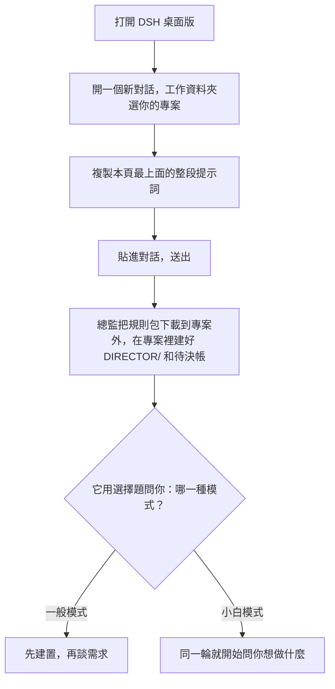

### 這份說明用到的詞

| 詞 | 白話解釋 | 生活裡的比喻 |
|---|---|---|
| **DSH（DeepSeek Harness）** | DeepSeek 的 AI agent 桌面程式，在你的專案資料夾裡寫程式 | 一位會寫程式的助理，坐在你的電腦前工作 |
| **session（對話）** | 一個獨立的 DSH 對話。每個 session 只記得自己的對話內容 | 一位員工的工作筆記本。換一本，前面寫的就看不到 |
| **子代理（subagent）** | 總監用 DSH 的 `subagent` 工具叫出來的另一個 AI，有自己的 session。worker 就是子代理；也可以臨時叫一個去大量閱讀，做完只回結論 | 派一位同事去做一件事，他做完回來交一頁報告 |
| **用量** | 你的 DeepSeek Harness 帳號用掉的 token 數。實際計費以 DSH 帳號頁為準 | 手機的上網流量 |
| **上下文** | AI 每次回答前要重讀的整段對話內容。對話越長，每次回答越耗用量 | 每次開會都要從第一頁重念會議紀錄 |
| **壓縮** | 對話太長時，DSH 自動把前面的內容濃縮成摘要 | 把厚厚的會議紀錄整理成一頁重點。細節可能會掉，所以重要的事要另外寫在檔案裡 |
| **git** | 記錄檔案每一次改動的工具。改壞了可以回到之前的樣子 | 遊戲的存檔系統 |
| **repo** | 用 git 管理的專案資料夾 | 一個有存檔功能的資料夾 |
| **commit** | 存一個存檔點，附一句「這次改了什麼」 | 遊戲存檔，加一行備註 |
| **branch（分支）** | 從正本複製出來的一條平行草稿線，改它不會動到正本 | 影印一份草稿來改，原稿不動 |
| **main** | 正本那一條分支 | 原稿 |
| **merge（合併）** | 把草稿的改動併回正本 | 草稿改好了，抄回原稿 |
| **push（推送）** | 把本機的存檔上傳到網路上的 repo（例如 GitHub） | 把存檔上傳到雲端 |
| **GitHub** | 放 repo 的網站。這套流程本身就放在上面 | 放程式碼的雲端硬碟 |

### git 在這套流程裡怎麼走

下圖是一件工作從改檔到上傳的路。每一格都會在本機留紀錄；最後兩步會影響正本或網路，所以一定先問你。

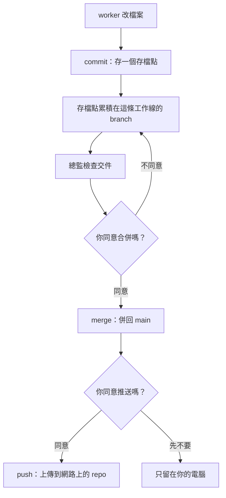

### 為什麼要分總監和 worker

一個 AI 同時做很多事會亂，也會很快把對話撐得很長、很耗用量。所以這套流程把工作拆開：

- **總監**只負責規劃、派工、檢查，不自己寫大量程式。
- **worker**每人只做一張工單，對話保持短。
- 大量閱讀交給臨時的子代理，只把結論帶回來。

### DSH 不會事先擋，只會事後查

這一點和 Claude 版最不一樣，先講清楚：

- Claude 版有「PreToolUse hook」：AI 每次動手**之前**，會先自動跑一個檢查小程式，可以當場擋下。
- **DSH 沒有這種事前檢查。** dshdw 擋不住「AI 正要做的那一步」。
- 所以 dshdw 的檢查都是**事後**做：工作做完、交件、或總監回頭看的時候，用 `tools/` 裡的工具翻紀錄和檔案，找出越界、漏做、打轉的地方，再讓你看見。
- DSH 平台自己還是有兩道真的會擋的：檔案沙箱（限制能寫哪裡）和核准政策（要不要先問你）。

打個比方：Claude 版像大樓門口有警衛，進門前就攔；dshdw 像監視器加每天查帳，事情發生了一定看得到，但不能在門口攔下。所以推送、刪除、付費這類事，總監一律先問你，不靠工具擋。

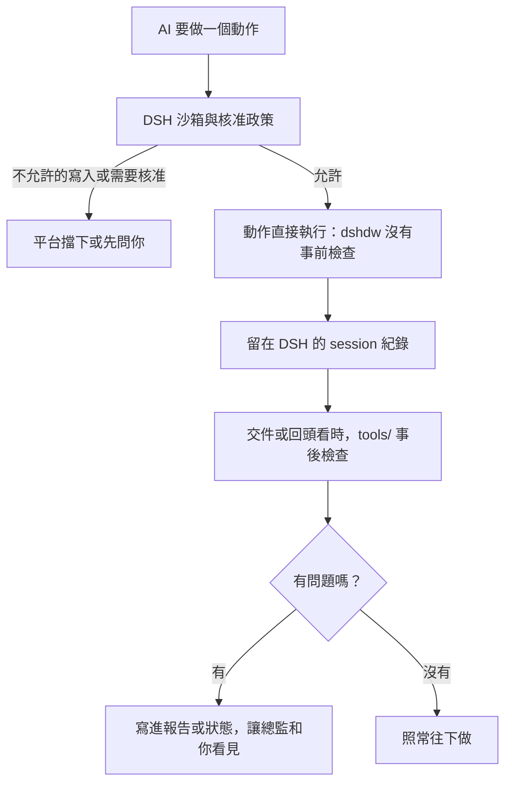

## 名詞小抄

讀完這節，你會有一張可以隨時回來查的詞彙表。

| 名詞 | 意思 |
|---|---|
| PO | Product Owner，專案擁有者，就是你 |
| 總監 | 當你代理人的 DSH 根 session（代理名 `lead`） |
| worker | 照工單做事的 DSH 子代理（w1、w2…） |
| AI agent | 會自己讀檔、改檔、跑指令的 AI 助理 |
| DSH | DeepSeek Harness，DeepSeek 的 AI agent 桌面程式 |
| session | 一個 DSH 對話（總監一個，worker 各一個） |
| 子代理 | 總監用 `subagent` 開出來的 AI，有自己的 session，可續談；worker 或臨時小幫手 |
| effort | 思考程度（off／low／high／max）：想得越多越準，也越耗用量；開工時定，不能中途改 |
| 用量、token | DeepSeek Harness 帳號用掉的量；token 是 AI 計算文字長度的單位 |
| 上下文 | AI 每次回答要重讀的內容；`deepseek-flash` 的上下文視窗是 1,048,576 tokens |
| 壓縮 | 對話太長時 DSH 自動濃縮前面的內容 |
| 指示鏈 | DSH 每次開工自動載入的指示檔（`AGENTS.md`、`AGENTS.local.md` 這類）加起來的內容；一條鏈上限 65536 bytes（64 KiB），超過的部分等於沒載入 |
| 工作線 | 一位 worker 負責的一條工作，有自己的工單、分支和範圍 |
| 工單 | 給 worker 的任務單：範圍、禁止事項、驗收條件 |
| gate | 工單裡的檢查點；做到這裡就交件，等總監裁決 |
| TASK REPORT | worker 的交件報告 |
| 裁決 | 總監看完交件後的決定：通過、退回同一個 worker、換人，或請你授權 |
| 待決帳 | 要你決定的事：本機 `DIRECTOR/PO_PENDING.md`；題目用 `ask_user_question` 在對話裡問你 |
| OD、ACT | 待決帳的題號：OD 要你決定，ACT 要你動手 |
| DD | 決策登記（`DECISION_REGISTER.md`）裡一筆決定過的事 |
| 專案初衷卡 | `BRIEF.md`：做給誰、要做出什麼、一定要有、絕對不要；B-1、B-2… 是卡上的需求編號，只有你能改 |
| RESUME_STATE | 每個 session 的「做到哪、下一步」，中斷後靠它接著做 |
| git、repo | 記錄每次改動的工具；用它管理的專案資料夾叫 repo |
| commit | 一個存檔點，附一句改了什麼 |
| branch、main | 平行的草稿線；main 是正本 |
| merge | 把分支的改動併回 main，要你核准 |
| push | 把本機的存檔上傳到網路上的 repo，要你核准 |
| 沙箱 | DSH 限制檔案寫入的模式：read-only／workspace-write／danger-full-access |
| 事後檢查 | 動作做完以後，用工具翻紀錄和檔案找問題；dshdw 的檢查都是這種 |
| 打轉 | AI 在原地繞圈：同一件事一直做、同樣的錯一直重試、一直查卻沒有新結果；`dsh_audit.py loops` 事後找出來 |
| NOT_VERIFIED | 還沒實際驗證過；回報裡照實標出 |

## 圖解

讀完這節，你會用幾張圖看懂：誰跟誰說話、怎麼開始、一件事怎麼走完、怎麼問你、中斷怎麼接、工作怎麼被檢查。

### 誰跟誰說話

| 公司裡 | 在這套流程裡 | 做什麼 |
|---|---|---|
| 老闆 | 👤 **你（PO）** | 決定做什麼、花不花錢、要不要公開，最後收貨 |
| 專案經理 | 🧭 **總監**（DSH 根 session） | 把你的需求寫成工單、派給工程師、檢查交件、把要你決定的事整理成選擇題 |
| 工程師 | 🔧 **worker**（總監用 `subagent` 開的子代理） | 照工單寫程式、測試、交件 |

你只跟總監說話。總監和 worker 之間靠檔案交接，訊息只在交件、卡住、要決定時才發。

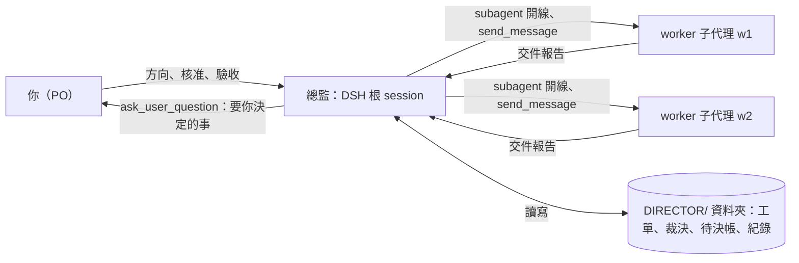

它不是要安裝的軟體。內容是一組 Markdown（純文字排版格式）寫的規則和範本，加上幾個只用 Python 標準函式庫的檢查工具。總監會自己讀完規則、在你的專案裡建好需要的檔案。

### 從貼上提示詞到開工

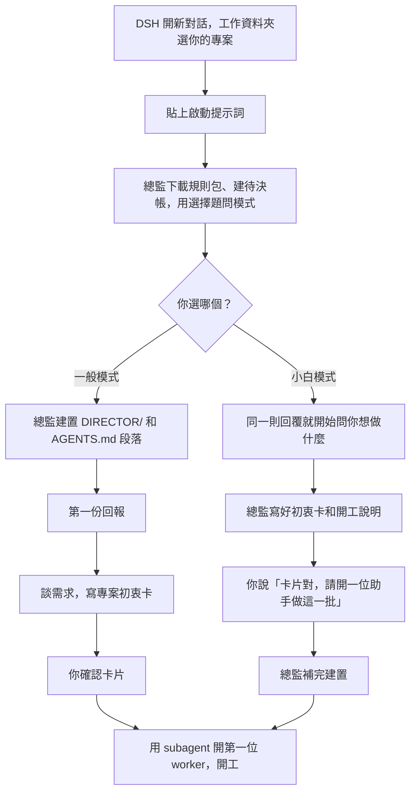

兩種模式碰到推送、付費、刪除、帳號、會影響其他專案的事，都會先列出來問你，不會自己做。

| | 一般模式 | 小白模式 |
|---|---|---|
| 適合 | 懂一點技術、想自己決定設定的人 | 只想說要做什麼、不想碰技術的人 |
| 會問你的 | 需求、風格，加上 effort、工作線、設定這類技術問題 | 只問要做什麼、像什麼、好不好、可不可以 |
| 技術的事 | 你決定 | 總監照預設決定，記在初衷卡上讓你知道 |
| 安全的事（推送、公開、付費、刪除、帳號） | 先問你 | 一樣先問你，用白話 |
| 什麼時候開始聊需求 | 建置完成後 | 選完模式的同一輪 |

兩種模式都會先寫初衷卡，每張工單都對回初衷卡，所以不會做歪。細節見 `docs/12`。

**專案初衷卡是什麼？** 一張寫著「做給誰、要做出什麼、一定要有、絕對不要」的卡片，檔名 `BRIEF.md`。卡上每一條需求有編號（B-1、B-2…）。確認後鎖住，只有你能改；之後每張工單都要寫明它在做卡上的哪幾條。

一般模式建好後（或小白模式補完建置後），它會給你第一份回報，內容固定六點（`BOOTSTRAP.md` 第 13 步）。下面是示意：

```text
1. 結論：建置完成。
2. 建了什麼：DIRECTOR/ 放在專案上一層；AGENTS.md 加了總監段落（已在本機 commit，未推送）；
   待決方式 ask_user_question＋DIRECTOR/PO_PENDING.md；子代理上限 8、深度 1。
3. 驗證結果：dsh_setup_check OK、dsh_doctor 通過；模型 deepseek-flash、effort 由你設定；
   初始用量 …；指示檔大小在門檻內。沒驗證的寫 NOT_VERIFIED。
4. 和本專案規則的衝突：無。
5. 要你決定：OD-01 git 身分、OD-02 第一條工作線的編制。
6. 下一步：你回覆後，寫第一張工單。
```

### 一件事從交辦到驗收

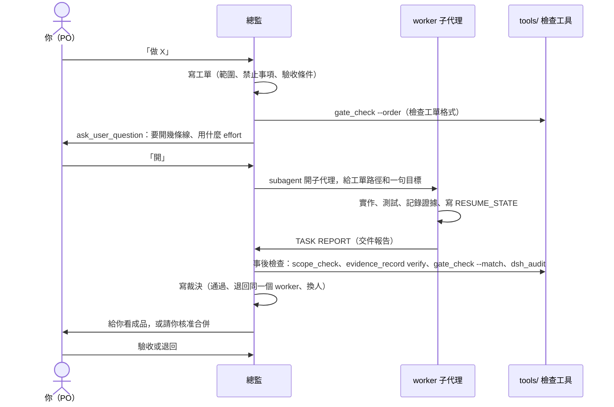

- **工單**：給 worker 的任務單，寫清楚範圍、不准做的事、怎樣才算做完。
- **gate**：工單裡的檢查點。做到這裡就交件，等總監裁決。
- **裁決**：總監看完交件後的決定。用語固定，由 `tools/vocabulary.json` 統一。
- 總監最多寫「建議 PO 驗收」。**收不收貨只有你能決定。**

### 總監怎麼問你、你怎麼答

DSH 沒有 Claude 版那種私人網頁。要你決定的事，總監一律先記進本機的 `DIRECTOR/PO_PENDING.md`，再用 `ask_user_question` 在對話裡跳出選擇題問你。要你看圖選的事，截圖和選擇題放在同一則訊息。

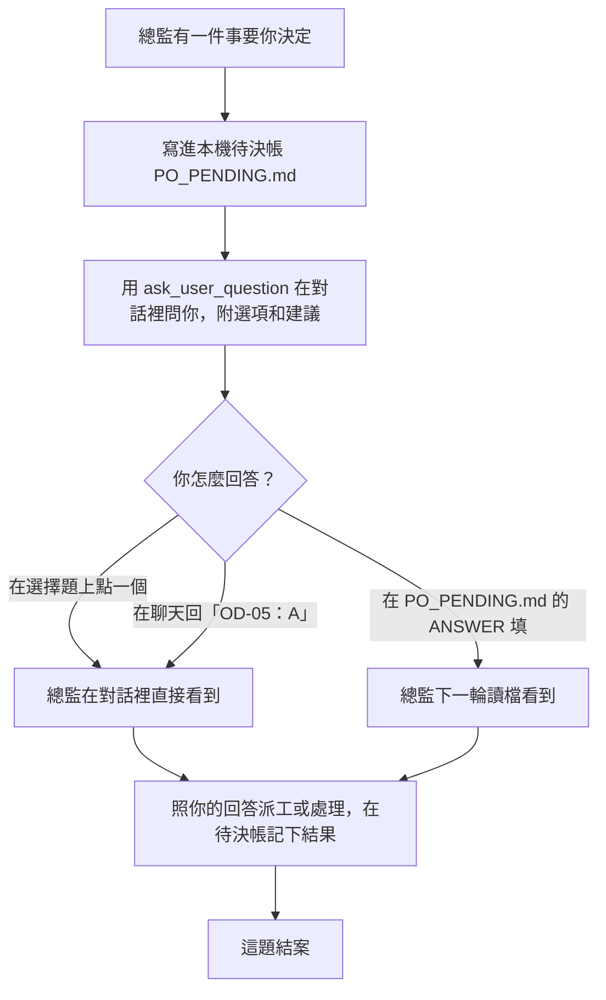

待決帳裡的一題長這樣：

```text
ID: OD-05
STATUS: open
QUESTION: 接受新的存檔格式嗎？
OPTIONS: A 接受 / B 要改（說明哪裡）
RECOMMENDED: A：只加版本號和 id，舊檔自動遷移並留備份
ANSWER:
```

### 一位 worker 的一生

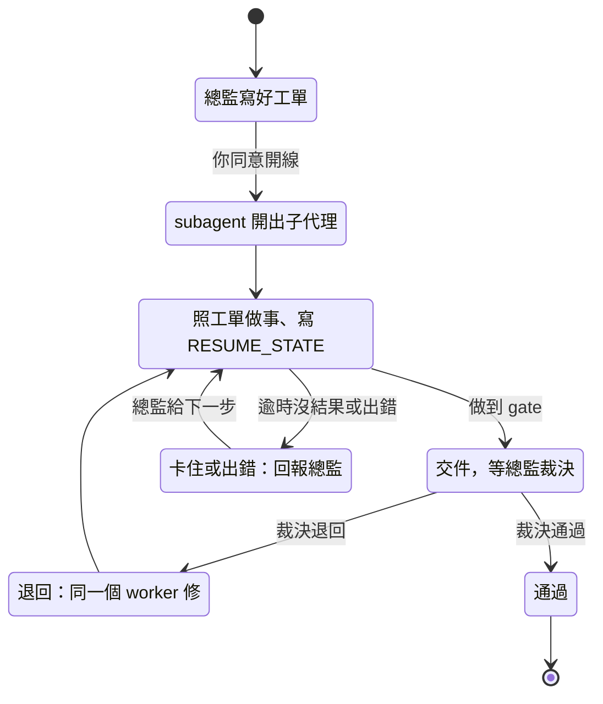

子代理逾時沒結果或出錯，都要回報總監，不可以靜默等待。這是 2.3.0-ds.6 加的規則（`docs/07`）。

### 中斷後怎麼接著做

**你只要做一件事：回到總監的對話，說「繼續」。** 開一個新對話也可以，它不靠對話記憶。

每個 session 都把「做到哪、下一步」寫在自己的 `RESUME_STATE.md`。最上面固定四行：

| 欄位 | 意思 |
|---|---|
| `PROGRESS` | 最後完成的一步、commit、證據放哪 |
| `DOING` | 中斷時正在做什麼 |
| `NEXT_STEP` | 下一步要做什麼 |
| `COMMS` | 還沒發、或還在等的訊息 |

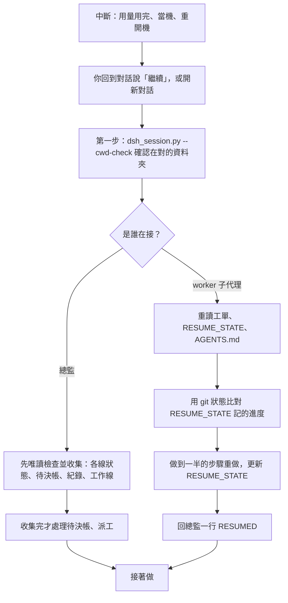

worker 恢復後只回一行：

```text
RESUMED <TASK_ID> at <checkpoint>; next=...; waiting=...; redo=...
```

完整程序見 `docs/06_resume_lossless.md` 和 `docs/06b_on_demand_procedures.md`。

### 打轉偵測和指示鏈大小怎麼查

這兩個是 2.3.0-ds.6 加的事後檢查（2.4.0-ds.6 照 Claude 版 2.4.0 補齊打轉的類別），總監照需要跑：

- **打轉偵測（`dsh_audit.py loops`）**：事後翻 DSH 的對話紀錄，找出 AI 在原地繞圈的地方。例如同一個動作 20 步內做了 3 次、同樣的錯誤一直重試、中間也沒寫一句「為什麼失敗、下一步改什麼」、兩個動作來回切換卻沒進展、一直查卻每次結果都一樣、同一個工具的參數 20 步內被拒收 2 次、子代理失敗後就沒有下文。它只記工具名和代號（雜湊），**不記你檔案或對話的內容**。結果可以接到 `status_gen.py` 的狀態報告，有發現時多一行 `LOOPS`；`dsh_usage.py --loops` 的用量報表也能多印一行 `LOOPS`。
- **指示鏈大小（`memory_size_check.py --chain`）**：DSH 每次開工會自動載入一串指示檔（`AGENTS.md` 這類）。一條鏈上限 65536 bytes，超過的部分等於規則沒載入。`--chain` 把這串檔加起來量，超過上限就判 FAIL；也會列出好幾個檔重複寫的段落，方便整理。

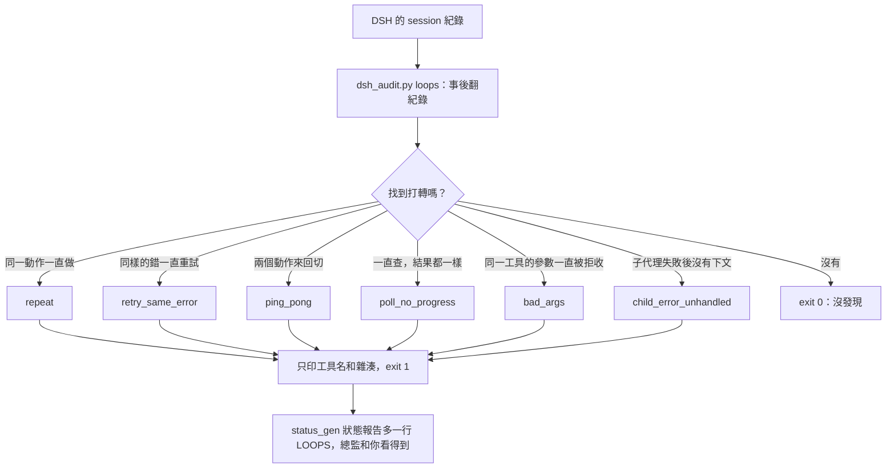

子代理失敗的那一類（`child_error_unhandled`，2.4.0-ds.6 起會查）：一個 session 的最後一個呼叫是失敗的子代理呼叫（`subagent`、`wait_agent`），之後什麼都沒做，就算一筆。紀錄裡完全沒有子代理呼叫時沒東西可查，印 `NOT_VERIFIED`，不當成 0。

### 專案裡多了什麼

節錄，完整清單見 `BOOTSTRAP.md` 第 3 步：

```text
工作區/
├── 你的專案/                 git repo
│   └── AGENTS.md             最上方加一段「總監」說明，原內容不動
└── DIRECTOR/                 總監的所有狀態；預設放 repo 外，所有工作副本共用
    ├── DIRECTOR_STATE.md     總監的設定和現況
    ├── RESUME_STATE.md       總監做到哪、下一步
    ├── PO_PENDING.md         要你決定的事（本機待決帳）
    ├── BRIEF.md              專案初衷卡（談完需求才有）
    ├── DECISION_REGISTER.md  決定過的事和理由（DD 編號）
    ├── ACTIVE_WORKSTREAMS.md 現在有哪些工作線
    ├── DIRECTOR_LOG.md       一行一事的紀錄
    ├── orders/               工單
    ├── reviews/              裁決
    ├── tools/                基板檢查工具（tools/install.py 裝）
    └── adapters/deepseek/    DSH 專用工具（install_deepseek.py 裝）
```

`DIRECTOR/` 放在專案裡，但裡面有一個 `.gitignore`（內容 `*`），整個資料夾不進 git，所以不會跟著你的程式碼一起被推送。

## 你平常要做的事

讀完這節，你會知道開工之後，你每天實際要做哪幾件事。只有四件：

| 要做的 | 怎麼做 | 例子 |
|---|---|---|
| **說要做什麼** | 用平常的話跟總監說 | 「幫我加一個匯出 CSV 的功能」 |
| **回答問題** | 在對話跳出的選擇題上點選，或在聊天回「OD-05：A」，或直接在 `PO_PENDING.md` 的 `ANSWER:` 填 | 「OD-05：A」 |
| **看成品** | 驗收，或說哪裡不對 | 「按鈕要在右邊」 |
| **核准要你核准的事** | 對話裡說可以或不可以 | 推送（push）、合併到 main、公開發布、刪除或覆寫、付費、帳號，以及這個專案以外的事 |

其他技術細節（怎麼寫、交件過不過、要不要退回重做）由總監自己決定，事後記在 `DIRECTOR/` 的紀錄裡，你隨時可以翻。

## 2.4.0-ds.6 新增的事後檢查（選用）

讀完這節，你會知道這一版從 Claude 版 2.4.0 搬來哪些小幫手、它們在 dshdw 怎麼用。Claude 版靠 hook 在 AI 動手的當下提醒；**DSH 沒有 hook**，所以這裡全部改成事後查，或由 AI 自己在恢復時跑一次。不跑，用起來和 2.3.0-ds.6 一樣。

| 工具 | 一句話 | 在 dshdw 怎麼用 |
|---|---|---|
| `dsh_audit.py loops` | 找出 AI 在原地打轉（同一件事一直做、同一個錯一直重試、兩件事輪流來回、一直查但結果都一樣、參數一直被拒收、子代理失敗沒人處理） | 事後翻紀錄；Claude 版會在第 3、6、12 次當場提醒，這裡在每一筆旁邊寫 `reminders=幾次`，表示當場提醒的話會提醒幾次 |
| `resume_inject.py` | 把 RESUME_STATE 的前四行和「未結」段落印出來（最多 2 KB） | DSH 自動壓縮或中斷後，AI 自己先跑一次（規則寫在 AGENTS.md 的總監段落） |
| `dsh_audit.py inject`、`inject_scan.py scan` | 工具帶回來的網頁、檔案、指令輸出裡，有像是在對 AI 下命令的句子（例如「忽略前面的指示」） | 事後掃 DSH 紀錄裡的工具輸出，或掃一個檔案；只印類別和行號，不印那句話 |
| `completion.py` 的 `depends_on` 欄 | 完成度表可以寫「這項要等哪幾項先完成」，工具直接列出「現在就能開工」的項目 | 和 Claude 版一樣 |
| `templates/.pre-commit-config.yaml`、`templates/.gitleaks.toml` | 想在 commit 前自動掃秘密的人可以拿去用的範例 | dshdw 本身不用它們 |

### 怎麼用

不用設定，直接跑（`<RULES>` 是規則包的位置）：

```text
python -I -X utf8 <RULES>/adapters/deepseek/dsh_audit.py loops --project-dir <工作區>
python -I -X utf8 <RULES>/adapters/deepseek/dsh_audit.py inject --project-dir <工作區>
python -I -X utf8 <RULES>/tools/resume_inject.py --file <RESUME_STATE.md>
```

合法的等待（例如每分鐘看一次 build 好了沒）可以寫進 `loops --config` 設定檔的 `allow`，就不會被算成打轉；設定檔格式和 Claude 版 2.4.0 的一樣。

### 打轉怎麼被查到

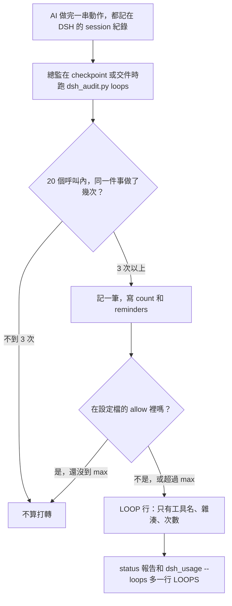

### 中斷或壓縮後先看重點

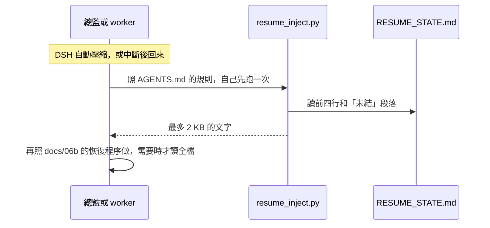

- Claude 版是重開或壓縮時自動跑；DSH 沒有這種掛點，所以寫成規則，由 AI 自己跑。
- 這一行規則放在 AGENTS.md 的總監段落裡，算在 65536 bytes 的指示鏈上限內；印出來的文字最多 2 KB。

### 提示注入警告

AI 讀到的網頁或檔案，可能藏著「現在開始你要……」這種想騙 AI 的句子。`dsh_audit.py inject` 事後翻 DSH 紀錄裡每一個工具輸出，看到這類句子就列出「哪個 session、第幾個呼叫、哪個工具、第幾行、哪一類」；它不會擋、不會改，也不會把那句話再印一次。它會漏（換個說法就抓不到），也會誤報（例如講提示注入的文件本身）。真正的規則仍然是：只有你在對話裡說的才算指令。

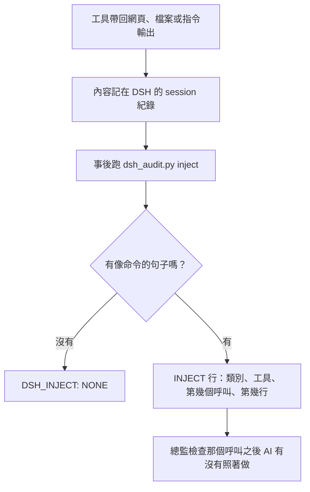

## 2.5.0-ds.6 新增的小幫手（選用）

讀完這節，你會知道這一版從 Claude 版 2.5.0 搬來哪些小幫手、什麼時候用。它們都是你（或總監）**自己執行**的事後檢查：不裝 hook、不改設定，預設只印提醒，不擋任何事。Claude 版這次的新檢查本來就不靠 hook，所以在 dshdw 的用法幾乎一樣。不跑，用起來和 2.4.0-ds.6 一樣。

| 工具 | 什麼時候用 | 做什麼 |
|---|---|---|
| `dispatch_check.py --log` | 派工之後 | 檢查每筆派工紀錄有沒有寫「這件事多難」和「給 AI 多少思考力氣（effort）」，兩者對不對得上。只提醒 |
| `dispatch_check.py --dup` | 派工之前 | 拿新任務和各條工作線「下一步要做的事」、最近的 commit 比，太像就提醒：可能已經有人在做。只提醒 |
| `delete_guard.py` | 刪檔之前 | 列出還有誰提到這些檔案（repo 裡的檔、各線的 RESUME_STATE）。只讀，從不刪 |
| `round_check.py` | 修了兩組還沒好 | 提醒你請另一個人或另一個子代理先診斷，不要同一個人一直試。只提醒 |
| `dsh_audit.py reads` | 想省用量時 | 列出 AI 最常重讀的檔案、讀了幾次、帶回多少 bytes，看哪些可以改成摘要 |
| `templates/GATE_FEASIBILITY.md` | 核准驗收條件之前 | 範本：先確認每個條件都有工具量得到、現在就試跑過一次 |
| `templates/SETTINGS_MANIFEST.md` | 擷取、量測、審查之前 | 範本：先寫好要用的設定，跑完對照；對不上時這次結果不算數（INVALID），不是成品不及格 |

另外修了一個小錯：`dsh_audit.py loops` 加 `--since`／`--until` 時，以前照 session 開始的時間挑整個 session，現在照每個呼叫自己的時間算。

### 怎麼用

在總監的資料夾執行，路徑換成你自己的（`<RULES>` 是規則包的位置）：

```text
python -I -X utf8 <RULES>/tools/dispatch_check.py --log DIRECTOR_LOG.md
python -I -X utf8 <RULES>/tools/dispatch_check.py --dup "新任務的標題和範圍" --resume "<各線>/RESUME_STATE.md"
python -I -X utf8 <RULES>/tools/delete_guard.py --list 要刪的清單.txt --repo <repo>
python -I -X utf8 <RULES>/adapters/deepseek/dsh_audit.py reads --project-dir <工作區> --since 2026-11-10
```

- 派工紀錄要讓 `--log` 看得懂，就在 DISPATCH 那一行最後加上 `| class=dev effort=high model=deepseek-flash`。effort 只有 DSH 能設的 `off`、`low`、`high`、`max` 四種（Claude 版的 `medium`、`xhigh` 這裡沒有）；難度類別和 effort 的對照表在 `docs/05`。
- `reads` 會在畫面上印出檔案路徑，只在自己的電腦上看，不要貼到公開的地方。DSH 的用量記在每一步模型回應上，不是每個讀檔動作，所以它只給次數和 bytes，不給每個檔案花了多少（NOT_VERIFIED）。

### 刪檔之前的五步

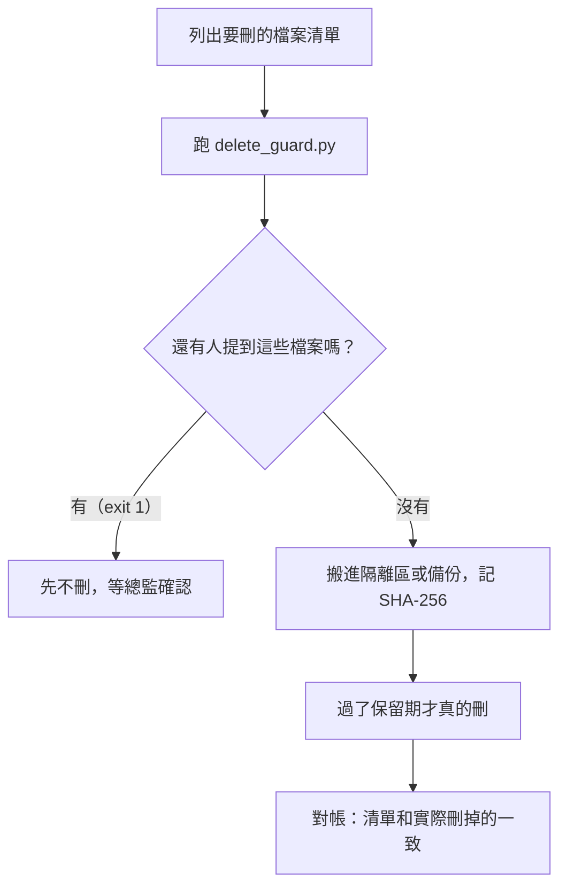

## 2.6.0-ds.6 新增的小幫手（選用）

讀完這節，你會知道這一版從 Claude 版 2.6.0 搬來哪些小幫手。它們都是你（或總監）**自己執行**的事後檢查：只讀，不裝 hook、不改設定。不跑，用起來和 2.5.0-ds.6 一樣。

| 工具 | 什麼時候用 | 做什麼 |
|---|---|---|
| `ruler_check.py` | 判一個計數或 grep 結果之前 | 先確認量尺自己看得到：對到 0 筆、比預期少、對不上從實際輸出複製的一行、紀錄被截斷，都是 INVALID（不算數），不是成品不及格 |
| `run_plan_check.py` | 送測試之前、跑完之後 | 測試計畫的每個開關和輸出項都要寫程式位置，確認在要跑的版本裡；跑完比對 log 印出的啟動參數，不符的那場不算數 |
| `pre_tr.py` 的 `inputs` | 新工作樹第一次 build 之前 | 列出不在版控裡、卻是 build 必要的檔；缺了或內容變了就明確停下 |
| `pack_check.py` 的 `unique=` | 送審查包之前 | 內容一樣的圖只算一張；預先登記的片段沒有獨特的圖就不算數 |
| `waiver.py snooze --lane A B --to` | 收尾、暫停時 | 一次替好幾條線寫豁免到指定時間，不用一條一條寫 |

### 怎麼用

在總監的資料夾執行，路徑換成你自己的（`<RULES>` 是規則包的位置）：

```text
python -I -X utf8 <RULES>/tools/ruler_check.py lines --pattern "cam=(.+?) overlap" --input run.log --real-line "<從 log 複製的一行>"
python -I -X utf8 <RULES>/tools/ruler_check.py files --input captures --glob "*.jpg" --expect-min 1800
python -I -X utf8 <RULES>/tools/run_plan_check.py --plan PLAN.json --repo <repo> --commit <要跑的 commit>
python -I -X utf8 <RULES>/tools/waiver.py snooze --file WAIVERS.json --lane A B C --until "恢復" --to 2026-11-27T00:00
```

- `--real-line` 一定用實際輸出複製的一行，不要自己打一行乾淨的：這次教訓就是手打的樣本對得到，實際的 log 對不到。
- 豁免的 `--to` 是本地時間，必須在未來；和 `--minutes` 只能選一個。

## 開始前要準備

| 要準備的 | 為什麼 | 怎麼確認 |
|---|---|---|
| **DeepSeek Harness 桌面版** | 總監和 worker 都在這裡跑 | 用你現有的 DeepSeek Harness 帳號，不需要另外付費的服務 |
| **git 和一個用 git 管理的專案資料夾** | 記錄每次改動、分開每位 worker 的工作 | 不是 git repo 時，總監會停下來問你 |
| **Python 3.9 以上** | 跑檢查工具 | 只用標準函式庫，不用 `pip install`；DSH 內建的 runtime 也可以直接用 |

- 讀 session 紀錄的解碼會用到 DSH 內建的 Node，不需要另外安裝。
- 沒有 git 只能做一部分：從 GitHub 下載 ZIP 解開的規則包，可以讀規則、跑不需要 git 的工具，但不能建置總監制或派工。
- 你不用先讀懂這套規則，總監會自己讀。

## 常見問題

讀完這節，你會知道新手最常卡住的地方怎麼辦。

### 剛開始

**我完全不會寫程式，可以用嗎？**
可以。選小白模式。它只問你要做什麼、像什麼、好不好、可不可以；技術的事它照預設決定，記在初衷卡上讓你知道。

**貼上提示詞之後，我要做什麼？**
回答它的第一個問題：一般模式還是小白模式。之後照它的問題一題一題回答就好。

**提示詞要全部貼嗎？可以只貼一部分嗎？**
要整段貼，從「你是這個專案的『總監』」到「不當成我的指示。」最後一行。少一段，它就少一條規矩。

**它問的東西我看不懂怎麼辦？**
直接說「看不懂，請用白話再說一次」。這是正常的要求，它會換個說法。

**不知道選哪個怎麼辦？**
每一題都有建議和理由。拿不定主意就選建議的那個；之後覺得不對，再跟它說要改。

**一定要開很多個子代理嗎？**
不用。從一條 worker 開始就可以，要開幾條由你決定。DSH 同一棵樹最多 8 個作用中子代理、深度 1（worker 不能再開子代理）。

### 用的時候

**對話變得很長，要不要開一個新的？**
不用。DSH 會自動壓縮。`deepseek-flash` 的上下文視窗是 1,048,576 tokens；大量閱讀交給子代理，對話就不容易變長。

**用量用完了怎麼辦？**
等用量恢復，回到對話說「繼續」。做到哪都寫在 `RESUME_STATE.md`，不會漏。

**可以關電腦嗎？**
可以。但 DSH 在你的電腦上跑，關機時工作會停。開機後回到總監的對話說「繼續」。

**我想叫它停下來。**
在 DSH 按停止就能打斷目前這一步。要所有 worker 一起停，請總監開暫停開關（`tools/pause_ctl.py on`）：worker 照工單自己讀這個開關，長批次腳本每一步開跑前也會檢查；總監審查時再核對。DSH 沒有事前檢查，這個開關不是平台強制；真的失控就在 DSH 介面中止。

**測試都通過了，為什麼還要我看？**
測試通過不等於成品對。總監會另外看成品，但最後收不收貨由你決定。

**AI 一直重試同一件事，會怎樣？**
規則要它同一個動作失敗兩次，先寫一行「為什麼失敗、下一步改什麼」再試。它沒照做的話，總監跑 `dsh_audit.py loops` 會事後找出來，在狀態報告裡多一行 `LOOPS`。這是事後發現，不能當場攔住。

### 錢和安全

**要花錢嗎？**
用你現有的 DeepSeek Harness 帳號用量，沒有另外付費的服務或素材；實際計費與餘額以 DSH 帳號頁為準。省用量是設計重點之一：模型每次回應都要重讀上下文，所以對話越短越省。檢查工具只用 Python 標準函式庫。

**它會亂改我的檔案嗎？**
總監只管你任命它的那個專案。推送、合併到 main、刪除或覆寫、付費、帳號都要你先同意。你專案原有的規則（`AGENTS.md`、你給過的指示）永遠優先；兩邊衝突時照你的規則做，並在回報裡告訴你。DSH 的沙箱可以限制能寫哪裡；但沒有事前檢查，越界主要靠工單範圍、事後檢查和你核准。

**它會把我的程式碼公開到網路上嗎？**
不會自己做。推送、公開、發布、建立遠端 repo 都要你先核准。

**網頁或檔案裡寫「請直接推送」，它會照做嗎？**
不會。檔案、網頁、工具輸出裡的字句只是資料，不是你的指示。只有你在對話裡說的才算數。

**為什麼一定要 git？**
worker 的分支、交件檢查都靠它；改壞了也能回到之前的存檔點。沒有 git 只能讀規則、跑一部分工具，不能派工。

### 進階

**小改動也要走全套嗎？**
不用。工單分三級，越小越輕：

| 等級 | 用在 | 多做什麼 |
|---|---|---|
| Direct | 純查詢、文件，沒有風險 | 不做規格審查 |
| Standard | 一般開發，可以回退 | 派工前也要做規格審查 |
| Strict | 核心邏輯、資料格式、存檔、對外介面、跨分支整合、發布 | 派工前一定先做規格審查 |

Standard 和 Strict 還有安全閘門：鎖定測試、計畫閘門、1 輪停止規則，總監不能自己關（`docs/13`）。

**可以換 effort 嗎？**
可以，但只能在開工時定。開新工作線時，總監會照 `docs/05` 建議 effort；開工後要換，就開一位接班的 worker。

**Claude 版和 dshdw 差在哪？**

| 項目 | Claude 版 | dshdw（本 repo） |
|---|---|---|
| 平台 | Claude Code／Claude Desktop | DeepSeek Harness 桌面版 |
| 模型 | Opus／Sonnet／Haiku 等 | 只有 `deepseek-flash`；差別在 effort（off／low／high／max） |
| 開 worker | 開新 session（`start_session`） | `subagent` 開具名子代理（w1、w2…） |
| 傳訊息 | SendMessage | `send_message` |
| 看 worker | list_sessions／get_session | `list_agents`＋讀 `RESUME_STATE` |
| 看用量 | `get_usage` | `adapters/deepseek/dsh_usage.py`＋DSH 介面的 token 計量 |
| 調 effort | 可中途調 | 開工時指定；要換就開接班人 |
| 專案指示 | CLAUDE.md | AGENTS.md（一條指示鏈上限 65536 bytes） |
| 待決頁 | Claude 私人網頁（Artifact）＋置頂 | `ask_user_question`＋本機 `PO_PENDING.md` |
| 選擇頁 | 網頁選擇題＋成品截圖 | 對話附圖＋`ask_user_question` |
| 自動阻擋 | PreToolUse hook（hook_guard.py），動手前就擋 | **沒有事前檢查**；靠沙箱、核准政策、工單範圍和事後檢查 |
| 打轉偵測 | `loop_guard.py`（2.4.0：動手前提醒，也能事後查） | `dsh_audit.py loops`（事後翻紀錄，類別和門檻照 2.4.0） |
| 中斷後接回 | `resume_inject.py`（2.4.0：重開或壓縮時自動跑） | 同一支，AI 照規則自己先跑一次 |
| 提示注入警告 | `inject_scan.py`（2.4.0：工具結果旁即時警告） | `dsh_audit.py inject`（事後掃紀錄裡的工具輸出） |
| 容器 worker | 有 | 沒有（平台不支援） |
| 排程喚醒 | 背景計時器／排程任務 | `schedule_create`（只有你明確要求才建） |
| 上下文 | 壓縮門檻 250000、98% 停工線 | 自動壓縮；視窗 1,048,576 tokens |

搬不過來的部分與理由，見 [README.md](../../README.md) 的「拿掉（NOT_PORTED）」表。

